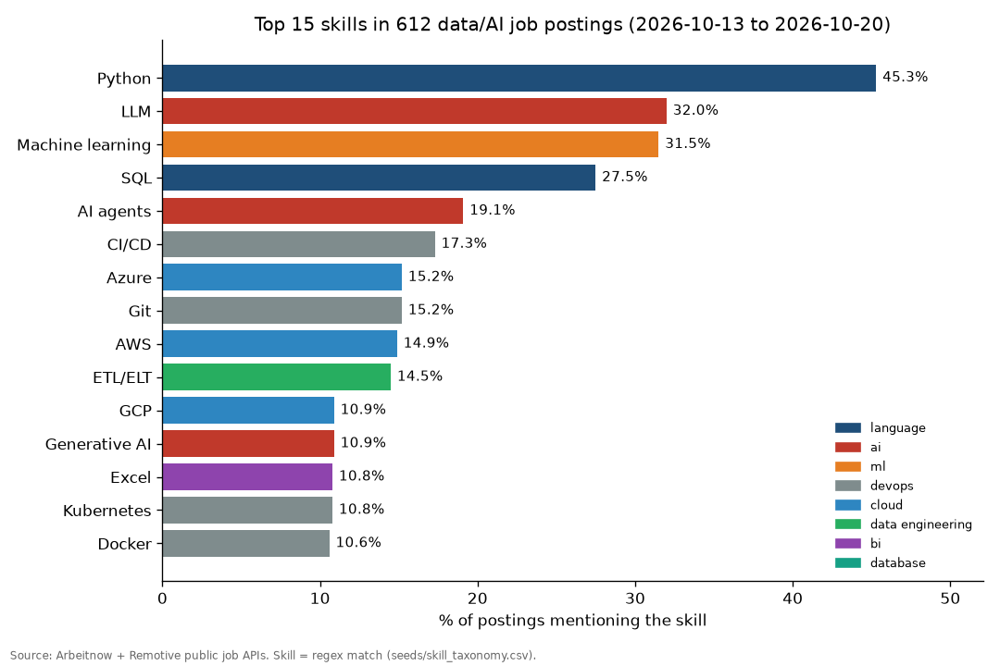

# HireMind

*AI that reads the job market for you: RAG over real data/AI job postings.*

**Proves:** "RAG", "LLM", "LLM evaluation", "SQL", "Python", "dbt-style data modelling", "CI/CD", "Docker", "MLOps"

A data pipeline and RAG assistant over 612 real data/AI job postings, built for job seekers and hiring teams who want to know which skills the market asks for, ask questions about the postings with cited sources, and see which skills a CV is missing.

## Demo



`python -m jobrag ask "Which jobs want RAG and vector database experience?"` (no API key, hybrid retrieval; full output in [docs/example_ask.txt](docs/example_ask.txt)):

```text
[retriever=hybrid, generator=extractive]

Top 5 matching postings.
Skills they ask for most: Python (5/5), RAG (4/5), AWS (3/5), Git (3/5), LLM (3/5), LangChain/LlamaIndex (3/5).
RAG is mentioned in 4 of 5 of these postings.
Vector databases is mentioned in 2 of 5 of these postings.
- [arbeitnow-lead-ai-engineer-freelance-paris-485024] Lead AI engineer - Freelance – Mirakl - Labs: "…Strong experience with LLMs, RAG, AI Agents, evaluation, and production systems…" (https://www.arbeitnow.fr/jobs/companies/mirakl-labs/lead-ai-engineer-freelance-paris-485024)
- [arbeitnow-senior-generative-ai-engineer-zurich-65961] Senior Generative AI Engineer – SwissPeak Partners GmbH: "…design and deliver enterprise-grade Generative AI solutions with a strong focus on Retrieval-Augmented Generation (RAG)." (https://www.arbeitnow.ch/jobs/companies/swisspeak-partners-gmbh/senior-generative-ai-engineer-zurich-65961)
- [arbeitnow-ai-engineer-analytics-end-user-insights-dusseldorf-433069] AI Engineer - Analytics & End-User Insights – Intersnack IT KG: "…Hands-on experience with prompt engineering, vector stores, and RAG patterns…" (https://www.arbeitnow.com/jobs/companies/intersnack-it-kg/ai-engineer-analytics-end-user-insights-dusseldorf-433069)
- ... 2 more
```

## How it works

- **Ingest:** `jobrag/ingest.py` pulls postings from the free [Arbeitnow](https://www.arbeitnow.com) and [Remotive](https://remotive.com) job APIs, keeps data/AI titles, and caches the raw JSON. Every posting keeps its link back to the source.
- **Model:** HTML is cleaned and the postings are loaded into DuckDB. Plain-SQL models in `models/` run in dbt-style layers (`staging` → `intermediate` → `marts`): dedupe, role family, skill extraction, skill frequency, skill co-occurrence (with lift), skills by role family, and salary where a posting states one.
- **Skills:** a transparent regex taxonomy of 51 skills in `seeds/skill_taxonomy.csv`. DuckDB (for the marts) and Python (for CV matching) both use this one file, and a test checks they agree on every posting.
- **RAG:** postings are cut into overlapping 120-word chunks and embedded locally on CPU with `intfloat/multilingual-e5-small`, then searched with numpy cosine similarity. That ranking is fused with TF-IDF using Reciprocal Rank Fusion. `/ask` returns an answer that cites posting IDs and URLs: generated by OpenAI or Anthropic if a key is set, built from extracted snippets if not. `/match` takes CV text and returns the closest postings plus the skills they ask for that the CV lacks.
- **Evals:** 46 questions in `evals/eval_set.jsonl`. 34 are hand-written "find this posting" questions in a job seeker's words, and 12 are "jobs that need skill X" questions. Recall@5, MRR, and precision@5 are reported for each retriever.

## Results

Live snapshot fetched 2026-10-20: **712 postings fetched, 703 with data/AI titles, 612 unique after deduplication** (354 companies, published 2026-10-13 to 2026-10-20). 73% are in English and the rest are mostly German, with some Dutch and French.

Top 10 skills (share of the 612 postings):

| # | Skill | Postings | Share |
|---|---|---|---|
| 1 | Python | 277 | 45.3% |
| 2 | LLM | 196 | 32.0% |
| 3 | Machine learning | 193 | 31.5% |
| 4 | SQL | 168 | 27.5% |
| 5 | AI agents | 117 | 19.1% |
| 6 | CI/CD | 106 | 17.3% |
| 7 | Azure | 93 | 15.2% |
| 8 | Git | 93 | 15.2% |
| 9 | AWS | 91 | 14.9% |
| 10 | ETL/ELT | 89 | 14.5% |

Also: Docker 10.6%, MLOps 9.5%, RAG 8.7%, dbt 7.5%, Power BI 6.7%. SQL is asked for in 82% of analytics-engineer, 65% of BI/data-analyst, and 61% of data-engineer postings. Only 54 postings state a salary.

Retrieval evals on the full 612-posting corpus (`evals/results_full.json`):

| Retriever | Known-item recall@5 | Known-item MRR | Skill precision@5 |
|---|---|---|---|
| TF-IDF baseline | 0.794 | **0.742** | 0.783 |
| Embeddings, all-MiniLM-L6-v2 (first try) | 0.706 | 0.562 | 0.600 |
| Embeddings, multilingual-e5-small | **0.853** | 0.679 | 0.800 |
| Hybrid (e5 + TF-IDF, RRF), the default | **0.853** | 0.718 | **0.933** |

**What failed at first:** the first embedding model, English-only all-MiniLM-L6-v2, scored *below* the TF-IDF baseline (recall@5 0.706 vs 0.794). Splitting the eval by language showed why. On English postings it was close to TF-IDF (0.86 vs 0.90). On the 27% of postings written in German, Dutch, or French it fell to 0.46. **Fix:** a multilingual model trained for retrieval (`multilingual-e5-small`, with its `query:`/`passage:` prefixes) raised non-English recall@5 to 0.77 and overall recall@5 to 0.853. TF-IDF still ranks exact keyword matches first more often (best MRR), so the default fuses both. On the committed 134-posting sample, TF-IDF (what CI runs) scores recall@5 0.971 (`evals/results_sample.json`).

Caveats: this is a one-week snapshot of two European-leaning job boards. Remotive's free feed returned only 10 postings, so 611 of the 612 come from Arbeitnow. Skills are keyword matches, not a model's judgement. The eval set is small and was labelled by one person.

## Run it

```bash
pip install -r requirements.txt            # core: pipeline, SQL, TF-IDF, API, tests
make demo                                  # fully offline: committed sample, no key, no network

# live data + local embeddings
make install-embed                         # CPU torch + sentence-transformers (optional)
python -m jobrag ingest                    # fetch live postings (respect the APIs: a few times a day max)
python -m jobrag build                     # DuckDB + SQL models
python -m jobrag index                     # embed chunks (resumable, cached per chunk)
python -m jobrag report                    # print the marts
python -m jobrag ask "Which jobs ask for dbt and Snowflake?"
python -m jobrag match my_cv.txt
python -m jobrag eval --out evals/results_full.json

uvicorn jobrag.api:app --port 8000         # POST /ask {"question": ...}, POST /match {"cv_text": ...}
docker build -t hiremind . && docker run -p 8000:8000 hiremind

make test && make lint                     # 30 offline tests + ruff (same as CI)
```

To get generated answers, copy `.env.example` to `.env` and set `OPENAI_API_KEY` or `ANTHROPIC_API_KEY`. Without a key, everything still works in extractive mode.

Data: job postings © their publishers, via the [Arbeitnow](https://www.arbeitnow.com) and [Remotive](https://remotive.com) public APIs. Every posting links back to its source. The committed sample (`data/sample/`) contains Arbeitnow postings only. Remotive asks that its jobs not be redistributed, so Remotive data stays in the local, git-ignored cache.

## What I'd do next

- Use an LLM to extract skills with confidence scores, check it against the regex taxonomy on a hand-labelled set of 100 postings, and add a reranker (cross-encoder) evaluated with the same recall@5 and MRR.
- Schedule the ingest daily (GitHub Actions cron) and turn the snapshots into a time series, so the marts show which skills are rising or falling, not just a one-week picture.
